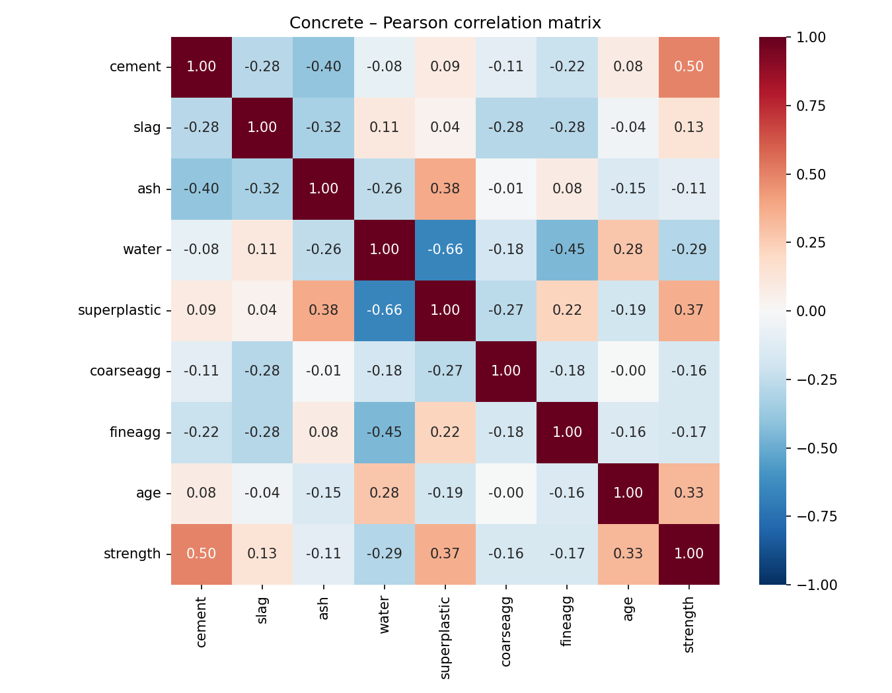
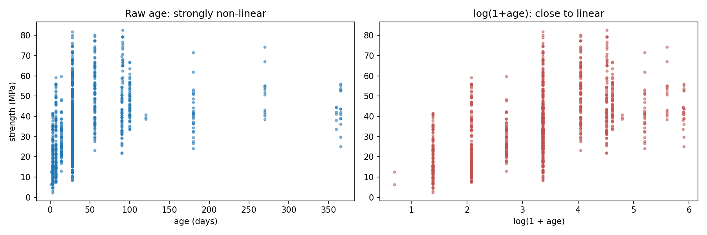
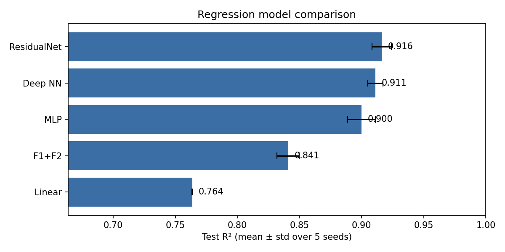
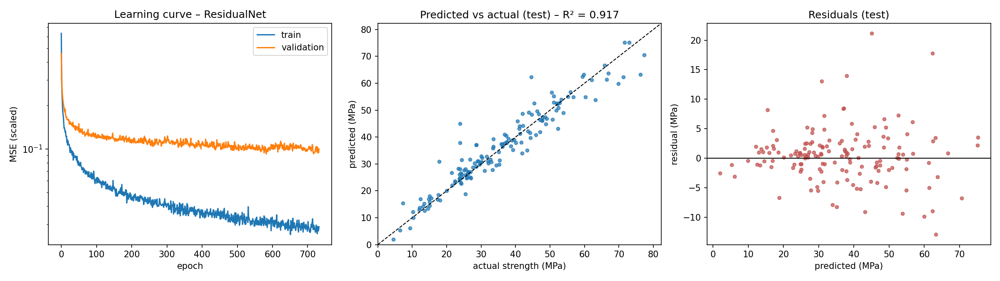
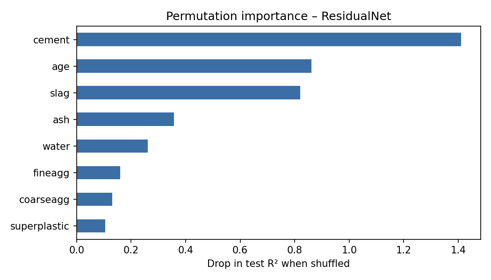
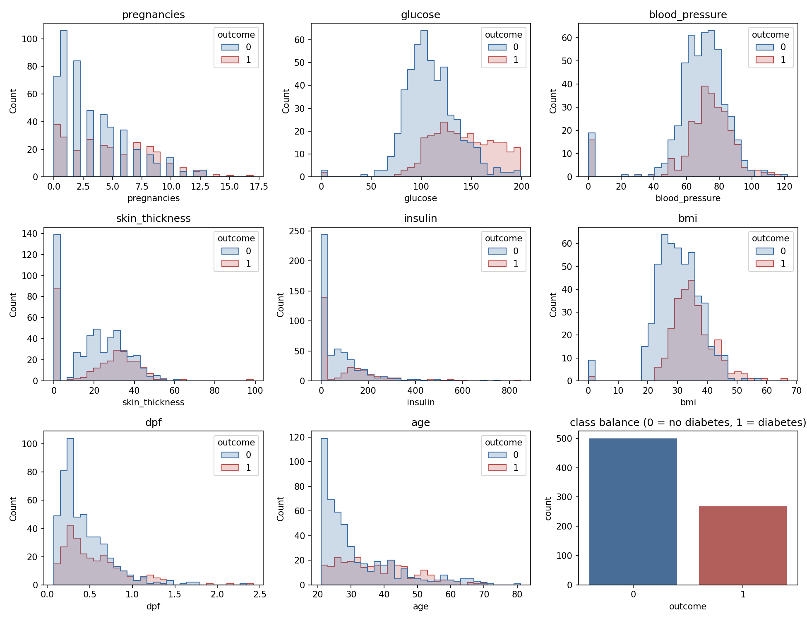
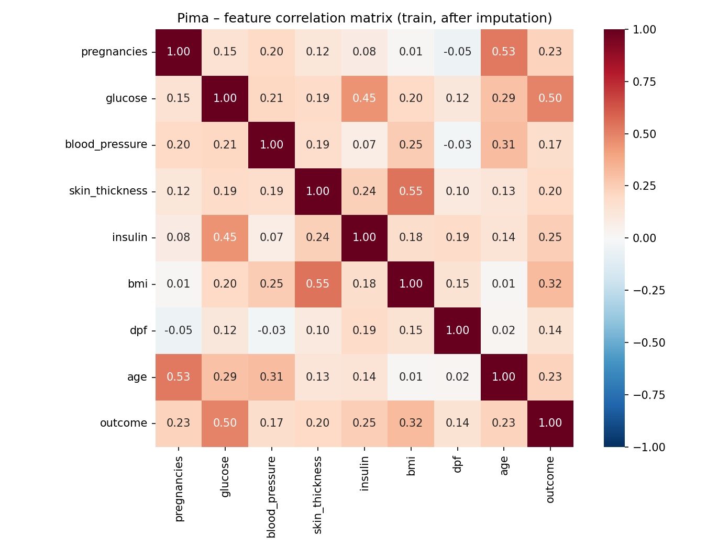
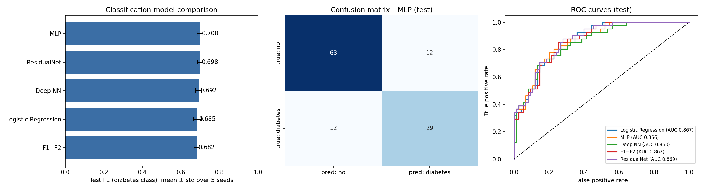
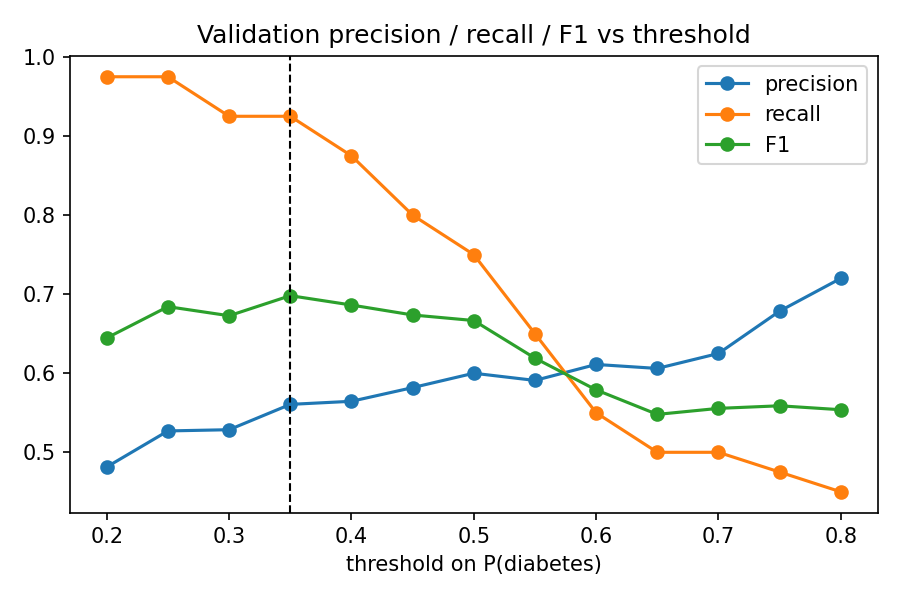
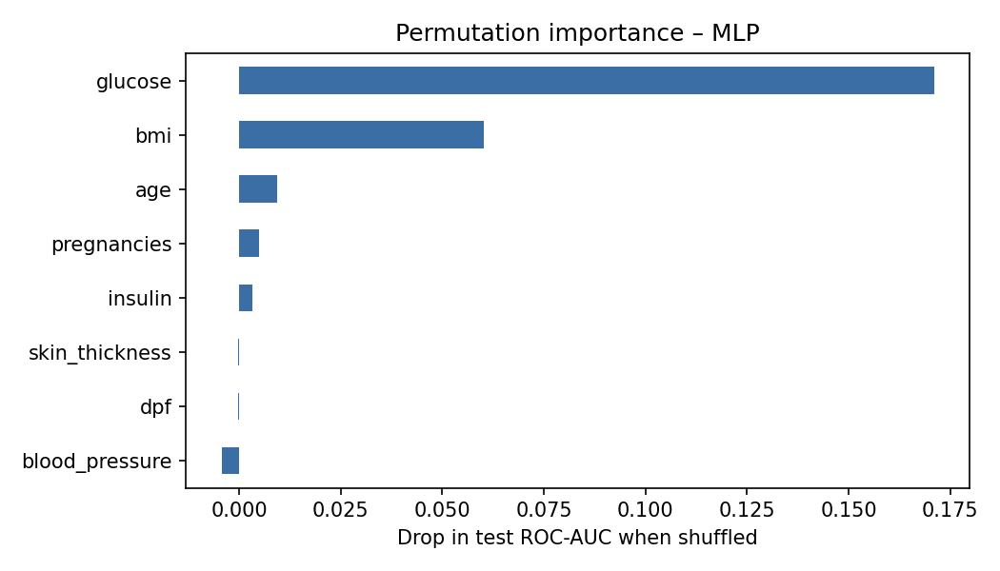

# Regression and Classification on Tabular Data with PyTorch, ONNX and GitHub Pages

**Student:** Hoang Thien Thanh Le (Tea)  
**Course:** ITS 52000 – Applied Machine Learning, Purdue University Northwest  
**Live demo:** https://acteavity.github.io/ml-onnx-deploy/  
**Code:** https://github.com/acteavity/ml-onnx-deploy

## 1. Overview

Two complete machine-learning pipelines were built on public tabular datasets: a **regression** model that predicts
concrete compressive strength and a **classification** model that predicts diabetes. For each task five PyTorch
architectures discussed in class were trained with the same loop and compared — a linear model, a one-hidden-layer
MLP, a deeper network with dropout, the **F1+F2** (linear + non-linear) model and a **residual network**. Each
architecture was trained with five random seeds and the deployed model was selected on a held-out validation set,
so the test set is used only for the final report. Following the class deployment example, all pre-processing
statistics are stored inside the model, which is exported with `torch.onnx.export` (opset 15, `input1` → `output1`)
and executed in the browser with onnxruntime-web on GitHub Pages.

## 2. Part 1 — Regression: Concrete Compressive Strength

### 2.1 Data
The Concrete Compressive Strength dataset (Yeh, 1998; UCI repository) has 1030 laboratory samples with
8 numeric inputs — cement, blast-furnace slag, fly ash, water, superplasticizer, coarse and fine aggregate
(kg/m³) and age (days) — and the target compressive strength in MPa. There are no missing values;
25 duplicated rows were removed so that identical samples cannot leak between the training
and test sets. The data were split 70/15/15 into training (703), validation (151) and test
(151) sets.

Cement (r = 0.50), superplasticizer (r = 0.37)
and age (r = 0.33) correlate positively with strength, while water is negative
(r = -0.29), reflecting the well-known water-to-cement ratio effect.

### 2.2 Processing
* **Feature engineering:** age is right-skewed (1–365 days) and strength gain saturates after about 28 days, so
  `log(1 + age)` is used (figure below).
* **Standardization:** inputs and target are z-scored with training-set means and standard deviations; the network
  predicts the scaled target and the output is de-scaled to MPa.
* Both steps are implemented inside `forward()`, so the ONNX file accepts raw values.

### 2.3 Models and training
Loss MSE on the scaled target, Adam (lr 1e-3, weight decay 1e-5), batch 32, up to 2 000 epochs with early stopping
on validation loss (patience 150) and restoration of the best weights.

### 2.4 Results

| Model | Val R² | Test R² (mean ± std) | Test MAE (MPa) | Test RMSE (MPa) | Epochs |
|---|---|---|---|---|---|
| Linear | 0.812 | 0.764 ± 0.000 | 6.04 | 7.70 | 470 |
| MLP | 0.910 | 0.900 ± 0.011 | 3.42 | 5.01 | 854 |
| Deep NN | 0.905 | 0.911 ± 0.006 | 3.18 | 4.72 | 354 |
| F1+F2 | 0.856 | 0.841 ± 0.009 | 4.97 | 6.32 | 1528 |
| ResidualNet ★ | 0.917 | 0.916 ± 0.008 | 3.15 | 4.59 | 733 |

★ = deployed model (highest mean validation R²).

The deployed **ResidualNet** reaches **R² = 0.917** on the test set, with
MAE = 3.11 MPa and RMSE = 4.56 MPa.

### 2.5 Analysis
* **Non-linearity matters.** The linear model explains 0.764 of the variance, while the best non-linear model (ResidualNet) reaches 0.916 — an improvement of 0.152 in R². Strength depends on interactions such as the water/cement ratio and on a saturating ageing curve, which a linear model cannot represent.
* **Feature engineering is a cheap win.** Replacing raw age with `log(1+age)` raised the linear model from
  R² = 0.506 to 0.764 and the MLP from 0.878 to 0.900. Domain knowledge narrows the gap
  between simple and complex models.

| Model | raw age | log(1+age) |
|---|---|---|
| Linear | 0.506 | 0.764 |
| MLP | 0.878 | 0.900 |

* **Ranking of the networks.** ResidualNet (0.916 ± 0.008), Deep NN (0.911 ± 0.006) and MLP (0.900 ± 0.011) are
  within about one standard deviation of each other, so their order should not be over-interpreted; all three clearly
  beat the Linear model. The Linear model has almost zero seed variance because its loss is convex and every seed
  converges to the same solution.
* **F1+F2 underfits.** The F1+F2 model (R² = 0.841) needed the most epochs (≈ 1 500) yet stayed well below the other
  networks: its non-linear branch has only 10 sigmoid units, which is not enough capacity for this problem. The
  linear part helps, but the small non-linear part limits the model.
* **Generalization.** The ResidualNet learning curve shows the training loss still decreasing while the validation
  loss levels off after about 300 epochs, a mild overfitting gap. Early stopping restored the best-validation weights,
  and the test R² (0.917) matches the validation R² (0.917), so the model generalizes well.
* **Error pattern.** In the predicted-vs-actual plot the points follow the diagonal across the whole 2–80 MPa range.
  Most residuals are within ±5 MPa with no visible trend against the prediction, so there is no systematic bias. A few
  large errors remain (up to +21 MPa, e.g. a ~24 MPa sample predicted at ~45 MPa); these are probably mixes with
  unusual recipes that are under-represented in the training data.
* **Feature importance.** Permutation importance ranks **cement, age and slag** as the most influential inputs.
  Shuffling cement drops R² by 1.41, which means R² becomes negative (worse than predicting the mean). This matches
  concrete engineering: strength is driven mainly by binder content (cement plus slag) and curing time. Slag has a weak
  linear correlation with strength (r = 0.13), yet it is the third most important input for the network, which shows
  that its effect is non-linear and depends on interactions with other inputs.

## 3. Part 2 — Classification: Pima Indians Diabetes

### 3.1 Data
768 female patients of Pima heritage aged ≥ 21 years, 8 clinical inputs (pregnancies, 2-h plasma glucose,
diastolic blood pressure, triceps skin-fold thickness, 2-h serum insulin, BMI, diabetes pedigree function, age) and a
binary outcome (diabetes within five years). The classes are imbalanced: 500 negative vs 268 positive
(34.9 % positive). A stratified 70/15/15 split gave 537 / 115 /
116 samples.

**Hidden missing values.** A value of 0 is physiologically impossible for glucose, blood pressure, skin thickness,
insulin and BMI. Zeros appear 374 times for insulin and 227 times for
skin thickness, so they were treated as missing.

### 3.2 Processing
* Zeros in those five columns are replaced by the **median of the non-zero training values**.
* Inputs are standardized with training-set statistics.
* The loss is **class-weighted cross-entropy** to counter the imbalance.
* Imputation and scaling are embedded in the model (`torch.where` + buffers), so the ONNX graph reproduces them in
  the browser; the exported model outputs softmax probabilities.

The correlation matrix shows that the outcome is most correlated with
glucose (r = 0.50), BMI (r = 0.32) and insulin (r = 0.25). Among the inputs, BMI–skin thickness (r ≈ 0.55),
age–pregnancies (r ≈ 0.53) and glucose–insulin (r ≈ 0.45) are the strongest pairs, but no pair is so highly correlated that a feature had to be dropped.

### 3.3 Models and training
Adam (lr 1e-3, weight decay 1e-4), batch 32, up to 1 000 epochs, early stopping on validation loss (patience 60),
five seeds per architecture.

### 3.4 Results

| Model | Val F1 | Test F1 (mean ± std) | Precision | Recall | Accuracy | MCC | ROC-AUC |
|---|---|---|---|---|---|---|---|
| Logistic Regression | 0.638 | 0.685 ± 0.020 | 0.698 | 0.673 | 0.781 | 0.518 | 0.859 |
| MLP ★ | 0.653 | 0.700 ± 0.015 | 0.690 | 0.712 | 0.784 | 0.533 | 0.861 |
| Deep NN | 0.649 | 0.692 ± 0.016 | 0.673 | 0.712 | 0.776 | 0.517 | 0.853 |
| F1+F2 | 0.646 | 0.682 ± 0.012 | 0.696 | 0.668 | 0.779 | 0.514 | 0.856 |
| ResidualNet | 0.647 | 0.698 ± 0.012 | 0.703 | 0.693 | 0.788 | 0.535 | 0.866 |

★ = deployed model (highest mean validation F1). F1, precision and recall refer to the diabetes class at threshold 0.5.

The deployed **MLP** obtains on the test set: **F1 = 0.707**, precision = 0.707,
recall = 0.707, accuracy = 0.793, MCC = 0.547 and ROC-AUC = 0.866.
Confusion matrix: TN = 63, FP = 12, FN = 12, TP = 29.

### 3.5 Analysis
* **Accuracy is not enough.** Because 65 % of patients are negative, a model that always predicts "no diabetes"
  would already reach about 65 % accuracy with F1 = 0. F1, recall, MCC and AUC are therefore the main metrics.
* **Model capacity.** The best mean test F1 is 0.700 (MLP) versus 0.685 for logistic regression, a difference of 0.015. On a small, noisy dataset with mostly monotonic risk factors, extra depth brings limited benefit and adds variance across seeds; data quality (about half of the insulin values are imputed) limits performance more than the architecture does.
* **All models rank patients almost equally well.** Test ROC-AUC is between 0.850 and 0.869 for all five models
  (the ROC curves overlap), and logistic regression alone already reaches 0.867. So the networks do not separate
  diabetic from non-diabetic patients much better than a linear model; they mainly shift where the 0.5 decision
  threshold falls, which changes the precision/recall balance.
* **Small test set.** There are only 41 diabetic patients in the test set, so one patient changes recall by about
  2.4 points. This explains why the validation F1 (≈ 0.64–0.65) and the test F1 (≈ 0.68–0.70) differ. Differences
  of 0.01–0.02 in F1 between models are within noise.
* **Errors.** The model misses 12 of 41 diabetic patients in the test set (false negatives) and raises
  12 false alarms. For screening, missing a diabetic patient is usually more costly than a false alarm.
* **Threshold.** A threshold of 0.35 chosen on the validation set changes test precision/recall
  from 0.707/0.707 to 0.647/0.805 (F1 0.707 →
  0.717). The web demo shows both decisions.
* **Feature importance.** Permutation importance ranks **glucose** far above the other inputs (AUC drop 0.171),
  followed by **BMI** (0.060) and **age** (0.009). This matches clinical knowledge that plasma glucose and adiposity
  are the main diabetes risk factors. Skin thickness, pedigree function and blood pressure have importance ≈ 0. Skin
  thickness is largely redundant with BMI (r ≈ 0.55 after imputation), and about 30 % of its values were imputed, so it
  adds little information once BMI is known.

## 4. Deployment with ONNX and GitHub Pages
1. The selected model is wrapped so that it returns a single tensor (MPa for regression; softmax probabilities for
   classification) and exported with `torch.onnx.export(..., input_names=["input1"], output_names=["output1"],
   opset_version=15, dynamic_axes=...)`, as in the class example.
2. The ONNX file is checked with onnxruntime in Python: the maximum difference to the PyTorch output is printed in the
   notebooks.
3. Static pages (`index.html` + `index.js`) load `onnxruntime-web`, build a `float32` tensor of shape `[1, 8]` from
   the form and call `session.run({ input1: tensor })`. A `metrics.json` file shows the evaluation results next to the
   prediction.
4. The `docs/` folder is published with GitHub Pages: https://acteavity.github.io/ml-onnx-deploy/regression/ and https://acteavity.github.io/ml-onnx-deploy/classification/.

## 5. Conclusion
For concrete strength, non-linear networks clearly outperform linear regression, and a domain-informed transform of
age gives a large improvement at no cost. For diabetes prediction, the gain from deeper networks is small; careful
handling of hidden missing values, class imbalance and the decision threshold matter more than architecture.
Embedding the pre-processing inside the PyTorch module makes the ONNX models self-contained, so both run fully in the
browser without a server.

## References
* Yeh, I-C. (1998). Modeling of strength of high-performance concrete using artificial neural networks. *Cement and
  Concrete Research*, 28(12), 1797–1808.
* Smith, J. W., Everhart, J. E., Dickson, W. C., Knowler, W. C., & Johannes, R. S. (1988). Using the ADAP learning
  algorithm to forecast the onset of diabetes mellitus. *Proc. Symposium on Computer Applications in Medical Care*, 261–265.
* Calix, R. A. ConstraintsMLprediction – ONNX deployment examples. https://github.com/rcalix1/ConstraintsMLprediction
* PyTorch ONNX export documentation; ONNX Runtime Web documentation.
